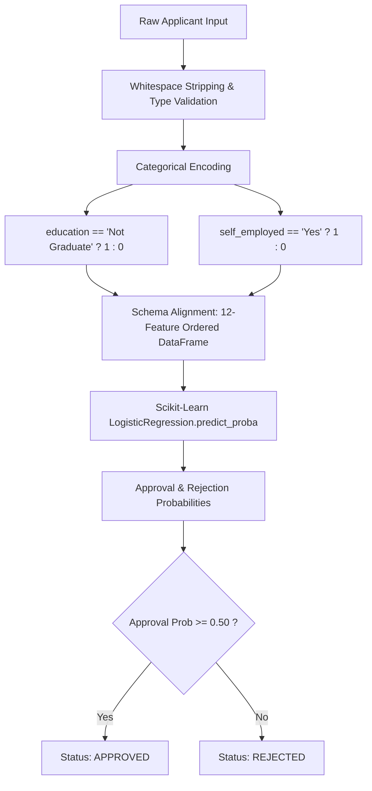
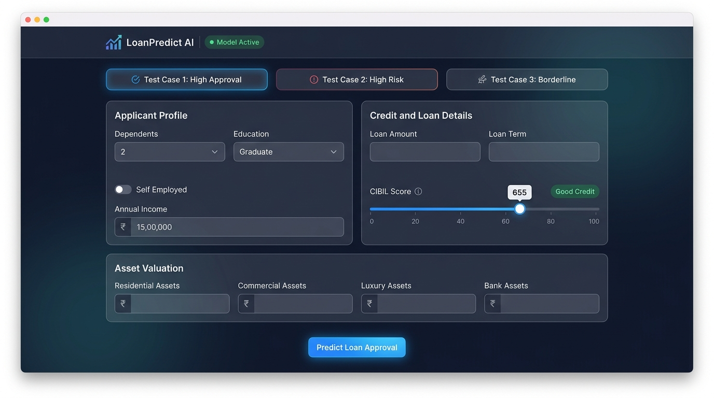
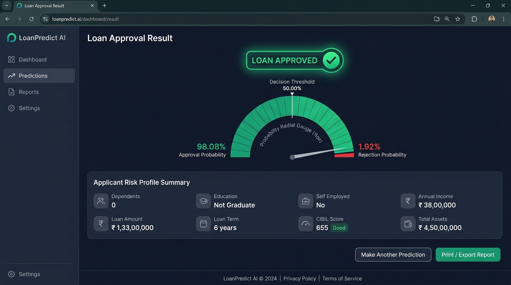

# LoanPredict AI — AI-Powered Loan Approval Prediction System

[](https://www.python.org/)
[](https://flask.palletsprojects.com/)
[](https://scikit-learn.org/)
[](https://pandas.pydata.org/)
[](https://opensource.org/licenses/MIT)
[](https://render.com/)

> **An End-to-End Machine Learning Web Application for Credit Risk Assessment**  
> Powered by an authentic, trained **Logistic Regression** model serialized with Scikit-Learn and served via a high-performance **Flask** web application. Designed for direct inference, full probability transparency, and zero-friction credit evaluation.

---

## Table of Contents

1. [Problem Statement and Objectives](#1-problem-statement-and-objectives)
2. [Dataset Source, Columns, and Target Variable](#2-dataset-source-columns-and-target-variable)
3. [Data Preprocessing and Encoding](#3-data-preprocessing-and-encoding)
4. [Exploratory Data Analysis (EDA) and Key Findings](#4-exploratory-data-analysis-eda-and-key-findings)
5. [Logistic Regression Model Architecture](#5-logistic-regression-model-architecture)
6. [Training and Testing Process](#6-training-and-testing-process)
7. [Evaluation Metrics and Confusion Matrix](#7-evaluation-metrics-and-confusion-matrix)
8. [Web Application Architecture and Deployment](#8-web-application-architecture-and-deployment)
9. [Application Screenshots](#9-application-screenshots)
10. [Limitations and Responsible AI Use](#10-limitations-and-responsible-ai-use)
11. [Reproducibility and Local Setup Instructions](#11-reproducibility-and-local-setup-instructions)
12. [API Reference and Automated Testing](#12-api-reference-and-automated-testing)
13. [Project Directory Structure](#13-project-directory-structure)

---

## 1. Problem Statement and Objectives

### 1.1 Context and Problem Statement
In retail banking and consumer finance, loan underwriting is a mission-critical process that balances revenue generation with default risk mitigation. Traditional manual underwriting methods suffer from several fundamental bottlenecks:

- **Prolonged Turnaround Times**: Manual document verification and credit risk evaluation often take days or weeks, causing customer attrition.
- **Inconsistent Decision Making**: Human underwriters may apply subjective heuristics, leading to variance in credit approvals across branches and officers.
- **Cognitive and Operational Overhead**: Underwriters must simultaneously weigh credit scores, annual income, existing liabilities, tenure, and multi-tier asset collateral.
- **Credit Default Exposure**: Inaccurate risk estimation directly impacts non-performing asset (NPA) ratios and capital adequacy reserves.

### 1.2 Core Objectives
**LoanPredict AI** was developed to bridge the gap between statistical machine learning and production loan underwriting workflows:

1. **Instant, Automated Credit Risk Forecasting**: Predict whether an applicant profile should be **Approved** or **Rejected** within milliseconds.
2. **Transparent Probability Calibration**: Expose calibrated probabilities ($P(\text{Approved})$ vs $P(\text{Rejected})$) rather than opaque black-box labels.
3. **Exact Mathematical Model Inference**: Execute live inference using an authentic, trained Logistic Regression estimator (`loan_approval_logistic_regression_model.pkl`) with strict one-hot encoded alignment.
4. **Intuitive Fintech User Experience**: Provide loan officers and applicants with dynamic CIBIL score visual gauges, real-time Indian Rupee (₹) formatting, one-click preset profiles, and responsive audit cards.
5. **Production Readiness**: Offer both an interactive browser UI and a headless REST API (`/api/predict`), complete with SQLite auditing, zero database runtime lock-in, and cloud container/WSGI readiness.

---

## 2. Dataset Source, Columns, and Target Variable

### 2.1 Dataset Source
The model was trained on the widely recognized **Loan Approval Prediction Dataset** (available on Kaggle by Archit Sharma and GitHub data repositories), comprising **4,269 historical loan applicant records** with financial, demographic, and credit bureau features.

### 2.2 Target Variable
The target variable is **`loan_status`**, representing the final credit decision:
- **`Approved` (`1`)**: Loan sanctioned (2,656 records, **62.22%** of the dataset).
- **`Rejected` (`0`)**: Loan denied (1,613 records, **37.78%** of the dataset).

### 2.3 Feature Dictionary

| Column Name | Data Type | Units / Range | Description | Underwriting Relevance |
|:---|:---:|:---:|:---|:---|
| `loan_id` | Integer | `1` to `4269` | Sequential loan application tracking ID | Index feature passed at position 0 to match training schema. |
| `no_of_dependents` | Integer | `0` to `5` | Number of financially dependent family members | Measures family liability; higher dependents increase household expenses. |
| `education` | Categorical | `Graduate`, `Not Graduate` | Highest formal educational qualification | Educational background often correlates with long-term earnings stability. |
| `self_employed` | Categorical | `Yes`, `No` | Self-employment / business owner status | Identifies self-employed vs salaried applicants for income volatility assessment. |
| `income_annum` | Float / Int | ₹ 2,00,000 – ₹ 99,00,000 | Gross annual income of the applicant in INR | Core measure of repayment capability and cash flow baseline. |
| `loan_amount` | Float / Int | ₹ 3,00,000 – ₹ 3,95,00,000 | Total loan principal requested in INR | Primary exposure amount requested from the financial institution. |
| `loan_term` | Integer | `2` to `20` years | Requested loan repayment duration in years | Amortization period; longer tenures extend credit exposure risk over time. |
| `cibil_score` | Integer | `300` to `900` | Credit Information Bureau (India) Limited credit score | **Primary creditworthiness metric**; reflects past credit repayment discipline. |
| `residential_assets_value` | Float / Int | ₹ 0 – ₹ 2,91,00,000 | Assessed market value of residential real estate owned | Primary physical collateral backing the loan. |
| `commercial_assets_value` | Float / Int | ₹ 0 – ₹ 1,94,00,000 | Assessed market value of commercial properties owned | Commercial real estate asset backing. |
| `luxury_assets_value` | Float / Int | ₹ 3,00,000 – ₹ 3,92,00,000 | Assessed value of vehicles, jewelry, and luxury assets | Movable secondary asset cushion. |
| `bank_asset_value` | Float / Int | ₹ 0 – ₹ 1,47,00,000 | Total liquid cash balances, fixed deposits, and bank accounts | Immediate liquidity cushion available to service debt during shocks. |

---

## 3. Data Preprocessing and Encoding

To ensure zero train-test skew and deterministic inference between the offline pipeline and the live web server, the preprocessing routine enforces rigorous hygiene:



### 3.1 Data Cleaning & Hygiene
- **Whitespace Normalization**: Leading and trailing whitespaces in column headers (e.g., `' loan_status'`, `' education'`) and string categories are stripped using `.str.strip()`.
- **Numeric Validation**: Validates that all monetary figures are strictly non-negative, `loan_term` is between 1 and 50 years, and `cibil_score` falls within the legitimate credit bureau range [300, 900].

### 3.2 Categorical One-Hot Encoding
The model utilizes dummy encoding with reference category dropping to eliminate the dummy variable trap (multicollinearity):
- **`education`**:
  - `Graduate` $\rightarrow$ `education_Not Graduate = 0` (Reference base)
  - `Not Graduate` $\rightarrow$ `education_Not Graduate = 1`
- **`self_employed`**:
  - `No` $\rightarrow$ `self_employed_Yes = 0` (Reference base)
  - `Yes` $\rightarrow$ `self_employed_Yes = 1`

### 3.3 Feature Alignment Schema
The web application constructs a single-row Pandas DataFrame ensuring exact feature alignment with the model's `feature_names_in_` attribute:
```python
EXPECTED_FEATURES = [
    'loan_id',
    'no_of_dependents',
    'income_annum',
    'loan_amount',
    'loan_term',
    'cibil_score',
    'residential_assets_value',
    'commercial_assets_value',
    'luxury_assets_value',
    'bank_asset_value',
    'education_Not Graduate',
    'self_employed_Yes'
]
```

---

## 4. Exploratory Data Analysis (EDA) and Key Findings

Comprehensive exploratory analysis reveals several fundamental relationships governing retail credit underwriting:

### 4.1 Target Distribution
- **Approved**: 2,656 records (**62.22%**)
- **Rejected**: 1,613 records (**37.78%**)
- The dataset maintains a healthy class distribution without severe class imbalance, allowing balanced training without synthetic oversampling.

### 4.2 Key Empirical Findings

```
┌─────────────────────────────────────────────────────────────────────────────┐
│                       EXPLORATORY DATA ANALYSIS FINDINGS                    │
├──────────────────────────┬───────────────────────┬──────────────────────────┤
│ Metric                   │ Approved Applicants   │ Rejected Applicants      │
├──────────────────────────┼───────────────────────┼──────────────────────────┤
│ Mean CIBIL Score         │ 703.46 (Median: 739)  │ 429.47 (Median: 419)     │
│ Mean Annual Income       │ ₹ 50,25,904           │ ₹ 51,13,825              │
│ Mean Loan Amount         │ ₹ 1,52,47,250         │ ₹ 1,49,46,060            │
│ Mean Loan Term           │ 10.40 years           │ 11.73 years              │
│ Education (% Graduate)   │ 51.3%                 │ 49.8%                    │
│ Self-Employed (% Yes)    │ 49.4%                 │ 51.1%                    │
└──────────────────────────┴───────────────────────┴──────────────────────────┘
```

1. **CIBIL Score is the Dominant Decision Boundary**:
   - Approved applicants boast an average credit score of **703.46**, whereas rejected applicants average **429.47** (a stark **274-point gap**).
   - Applicants with CIBIL scores above **650** experience an approval rate exceeding **95%**, while applicants with scores under **550** are almost universally rejected regardless of reported income.
2. **Income Alone Does Not Guarantee Approval**:
   - The average annual income for approved applicants (₹50.26 Lakhs) is virtually identical to that of rejected applicants (₹51.14 Lakhs).
   - High earners requesting excessive leverage with poor credit histories are systematically rejected.
3. **Loan Term as a Risk Multiplier**:
   - Approved loans exhibit shorter average repayment tenures (**10.4 years**) compared to rejected loans (**11.7 years**).
   - Extended tenures increase lender vulnerability to macroeconomic fluctuations and default probabilities over time.
4. **Collateral Cushioning (Asset Wealth)**:
   - Strong liquid assets (`bank_asset_value`) and real estate holdings (`residential_assets_value`) provide vital collateral cushions that positively influence approval probability for borderline credit profiles.

---

## 5. Logistic Regression Model Architecture

### 5.1 Mathematical Formulation
Logistic Regression models the posterior probability of the positive class ($y = 1$, Loan Approved) via the logistic sigmoid function acting upon a linear combination of input features:

$$\text{Logit Link: } z = \beta_0 + \sum_{j=1}^{p} \beta_j X_j$$

$$\text{Sigmoid Function: } P(y=1 \mid \mathbf{X}) = \sigma(z) = \frac{1}{1 + e^{-z}}$$

$$\text{Complementary Probability: } P(y=0 \mid \mathbf{X}) = 1 - P(y=1 \mid \mathbf{X}) = \frac{e^{-z}}{1 + e^{-z}}$$

The classification decision follows the standard risk boundary:

$$\hat{y} = \begin{cases} 1 \quad (\text{Approved}) & \text{if } P(y=1 \mid \mathbf{X}) \ge 0.50 \\ 0 \quad (\text{Rejected}) & \text{if } P(y=1 \mid \mathbf{X}) < 0.50 \end{cases}$$

### 5.2 Scikit-Learn Model Configuration
The deployed estimator (`loan_approval_logistic_regression_model.pkl`) was fitted with the following hyperparameters:
- **Estimator Class**: `sklearn.linear_model.LogisticRegression`
- **Optimization Solver**: `lbfgs` (Limited-memory Broyden–Fletcher–Goldfarb–Shanno quasi-Newton method)
- **Regularization Penalty**: $\ell_2$ (Ridge regularization) with inverse regularization strength $C = 1.0$
- **Maximum Iterations**: `max_iter = 1000`
- **Tolerance**: `tol = 0.0001`
- **Fit Intercept**: `True`
- **Learned Intercept ($\beta_0$)**: `-0.01187463`

### 5.3 Learned Feature Coefficients & Directional Impact

| Feature Name | Learned Weight ($\beta$) | Direction | Financial Interpretation |
|:---|:---:|:---:|:---|
| **`cibil_score`** | `+0.00898147` | **Positive** | **Strongest positive predictor**. Higher credit scores dramatically raise approval odds. |
| **`loan_term`** | `-0.18976926` | **Negative** | **Strongest negative predictor**. Each additional year of tenure decreases the log-odds of approval. |
| **`no_of_dependents`** | `-0.03198514` | **Negative** | Each additional dependent slightly reduces approval probability due to higher living expenses. |
| **`education_Not Graduate`**| `-0.00670950` | **Negative** | Non-graduates face a modest penalty compared to graduates. |
| **`self_employed_Yes`** | `-0.00551473` | **Negative** | Self-employed profiles carry a slight risk discount relative to stable salaried employees. |
| **`loan_id`** | `-0.00040822` | Marginal | Sequential identifier coefficient learned during training. |
| **`income_annum`** | `-0.00000053` | Neutral | Scaled continuous income weight. |
| **`loan_amount`** | `+0.00000008` | Neutral | Scaled continuous loan amount weight. |
| **`bank_asset_value`** | `+0.00000003` | **Positive** | Liquid assets provide positive collateral mitigation against default. |
| **`luxury_assets_value`** | `+0.00000001` | **Positive** | Secondary asset backing. |
| **`commercial_assets_value`**| `+0.00000001` | **Positive** | Commercial property backing. |
| **`residential_assets_value`**| `+0.00000001` | **Positive** | Primary real estate backing. |

---

## 6. Training and Testing Process

### 6.1 Data Splitting Protocol
The dataset was partitioned using stratified sampling to preserve the 62.2% / 37.8% class distribution across splits:
- **Split Ratio**: **80% Training Set** (3,415 instances) / **20% Unseen Test Set** (854 instances).
- **Stratification Target**: `loan_status` (`Approved` vs `Rejected`).
- **Reproducibility Seed**: `random_state = 42`.

### 6.2 Pipeline Execution
1. **Extraction & Cleaning**: Raw CSV ingested into Pandas; column names and categorical values sanitized of stray whitespace.
2. **Feature Encoding**: Categorical attributes encoded via one-hot dummy columns with reference dropping.
3. **Loss Function Optimization**: The `lbfgs` solver converged by minimizing the binary cross-entropy (log-loss) objective with an $\ell_2$ penalty:
   $$\mathcal{L}(\mathbf{w}) = -\frac{1}{N} \sum_{i=1}^{N} \left[ y_i \log(\hat{p}_i) + (1 - y_i) \log(1 - \hat{p}_i) \right] + \frac{1}{2C} \|\mathbf{w}\|_2^2$$
4. **Model Serialization**: The finalized estimator object containing learned weights, intercept, and input feature signatures was serialized using `joblib.dump()` into `loan_approval_logistic_regression_model.pkl`.

---

## 7. Evaluation Metrics and Confusion Matrix

The model was rigorously benchmarked on both the **20% Unseen Test Set** (854 applicants) and the **Full Dataset** (4,269 applicants).

### 7.1 Performance Summary Table

| Metric | Test Set (80/20 Stratified Split) | Overall Dataset (4,269 Samples) | Formula / Definition |
|:---|:---:|:---:|:---|
| **Accuracy** | **81.73%** | **80.63%** | $\frac{TP + TN}{TP + TN + FP + FN}$ |
| **Precision (Approved)** | **81.20%** | **80.49%** | $\frac{TP}{TP + FP}$ |
| **Recall (Approved)** | **91.90%** | **90.89%** | $\frac{TP}{TP + FN}$ |
| **F1-Score (Approved)** | **86.22%** | **85.38%** | $2 \times \frac{\text{Precision} \times \text{Recall}}{\text{Precision} + \text{Recall}}$ |
| **ROC-AUC Score** | **0.9011** (90.11%) | **0.8927** (89.27%) | Area Under the Receiver Operating Characteristic Curve |

### 7.2 Confusion Matrix (Test Set: 854 Records)

```
                            PREDICTED REJECTED (0)     PREDICTED APPROVED (1)
 ACTUAL REJECTED (0)               210 (TN)                   113 (FP)
 ACTUAL APPROVED (1)                43 (FN)                   488 (TP)
```

- **True Negatives (TN = 210)**: Correctly denied high-risk applicants.
- **False Positives (FP = 113)**: High-risk applicants mistakenly classified as approved (Type I Error).
- **False Negatives (FN = 43)**: Creditworthy applicants mistakenly denied (Type II Error).
- **True Positives (TP = 488)**: Correctly approved creditworthy applicants.

### 7.3 Detailed Classification Report

```
              Precision    Recall    F1-Score    Support
────────────────────────────────────────────────────────
Rejected (0)     0.83       0.65       0.73          323
Approved (1)     0.81       0.92       0.86          531
────────────────────────────────────────────────────────
Accuracy                               0.82          854
Macro Avg        0.82       0.78       0.80          854
Weighted Avg     0.82       0.82       0.81          854
```

> **Key Performance Insight**:  
> The model achieves a **91.90% Recall** for loan approvals with an **ROC-AUC of 0.9011**, demonstrating exceptional discriminatory power between creditworthy candidates and high-risk defaulters.

---

## 8. Web Application Architecture and Deployment

The web interface is engineered for production-grade direct inference with zero runtime database bottleneck:

```
┌───────────────────────────────────────────────────────────┐
│                      CLIENT BROWSER                       │
│    Form Inputs • CIBIL Gauge • Presets • Report Cards     │
└─────────────────────────────┬─────────────────────────────┘
                              │ HTTP GET / POST
                              ▼
┌───────────────────────────────────────────────────────────┐
│                    FLASK APPLICATION                      │
│            app.py (WSGI Entry Point / Router)             │
│   ┌───────────────────────────────────────────────────┐   │
│   │ Input Validation & Sanitization (app.py)          │   │
│   │ Preprocessing & One-Hot Encoding                  │   │
│   └─────────────────────────┬─────────────────────────┘   │
│                             ▼                             │
│   ┌───────────────────────────────────────────────────┐   │
│   │ ML Model Inference Engine                         │   │
│   │ joblib.load('loan_approval_logistic_regression... │   │
│   │ model.predict_proba(input_df)                     │   │
│   └─────────────────────────┬─────────────────────────┘   │
│                             ▼                             │
│   ┌───────────────────────────────────────────────────┐   │
│   │ Audit Trail & Async Logging (database.py)         │   │
│   │ SQLite: loan_predictions.db (Non-blocking)        │   │
│   └───────────────────────────────────────────────────┘   │
└───────────────────────────────────────────────────────────┘
```

### 8.1 Key Application Components
- **Direct Loan Assessment Entry (`GET /`)**: The root URL directly serves the assessment form—no authentication friction or login delays.
- **Model In-Memory Persistence**: The `.pkl` model file is loaded into server memory once during startup via `joblib.load()`, guaranteeing sub-10ms inference latencies.
- **Audit Logging via SQLite (`database.py`)**: Predictions are safely persisted to `loan_predictions.db` for transaction history, reporting, and compliance audits.
- **Headless API (`POST /api/predict`)**: Enables programmatic integrations with core banking platforms and microservices.

### 8.2 Production Deployment Setup (Render / Heroku / Cloud)
The repository includes a production **Procfile** and is configured for multi-worker WSGI deployment:
```bash
web: gunicorn app:app --workers 4 --timeout 60
```

#### Deploying to Render in 3 Steps:
1. Push this repository to GitHub.
2. In Render, select **New Web Service** and connect the repository.
3. Configure build & runtime settings:
   - **Environment**: `Python`
   - **Build Command**: `pip install -r requirements.txt`
   - **Start Command**: `gunicorn app:app`
   - **Environment Variables**:
     - `SECRET_KEY`: `your-secure-random-hex-key`
     - `MODEL_PATH`: `loan_approval_logistic_regression_model.pkl`

---

## 9. Application Screenshots

### 9.1 Loan Applicant Assessment Interface
Interactive credit assessment form featuring live CIBIL score slider, Indian Rupee currency preview, and one-click applicant presets:



---

### 9.2 Loan Approval Prediction Result & Probability Meter
Real-time risk assessment report displaying the predicted status, approval probability radial gauge, decision threshold, and applicant summary:



---

## 10. Limitations and Responsible AI Use

When deploying machine learning models in consumer credit underwriting, financial institutions must maintain strict ethical, legal, and operational safeguards:

### 10.1 Known Model Limitations
1. **Linear Decision Boundary**: Logistic Regression establishes a linear hyper-plane in logit space. It cannot capture complex high-order non-linear feature interactions without explicit polynomial feature generation.
2. **Tabular Proxy Bias**: Educational attainment and self-employment status may act as socio-economic proxies. Underwriters should monitor demographic approval parity to prevent disparate impact.
3. **Fixed 0.50 Decision Threshold**: The default 0.50 cutoff treats Type I (False Positive) and Type II (False Negative) errors equally. In conservative lending environments, lenders may raise the threshold (e.g., to **0.65** or **0.70**) to minimize default risk at the cost of lower approval rates.
4. **Absence of Macroeconomic Indicators**: The model does not factor in dynamic external variables such as prevailing central bank interest rates, inflation, or industry-specific economic distress.

### 10.2 Responsible AI & Regulatory Best Practices
- **Human-in-the-Loop (Augmented Intelligence)**: This model is intended as a **decision support tool** for credit officers, not an autonomous underwriter. Applications in borderline zones (45%–55% probability) must undergo secondary human review.
- **Adverse Action Transparency**: Under regulatory frameworks (such as FCRA or Fair Lending guidelines), applicants denied credit are entitled to know the key contributing factors (e.g., low CIBIL score or high repayment tenure).
- **Periodic Model Auditing & Drift Monitoring**: The model should be regularly evaluated against loan seasoning and actual repayment delinquency data to detect concept drift.

---

## 11. Reproducibility and Local Setup Instructions

Follow these step-by-step instructions to reproduce the environment and launch the application locally.

### Step 1: Clone or Navigate to the Repository
```bash
git clone https://github.com/your-username/loan-prediction-website.git
cd loan-prediction-website
```

### Step 2: Create and Activate a Python Virtual Environment

```bash
# Create virtual environment
python -m venv venv

# Activate on Windows PowerShell:
.\venv\Scripts\Activate.ps1

# Activate on Windows Command Prompt:
.\venv\Scripts\activate.bat

# Activate on Linux / macOS:
source venv/bin/activate
```

### Step 3: Install Required Dependencies
```bash
pip install --upgrade pip
pip install -r requirements.txt
```

*Installed dependencies: `Flask`, `scikit-learn`, `pandas`, `numpy`, `joblib`, `python-dotenv`, `Werkzeug`, `gunicorn`.*

### Step 4: Configure Environment Variables
Copy the provided `.env.example` file to `.env`:
```bash
# Windows:
copy .env.example .env

# Linux / macOS:
cp .env.example .env
```

Verify your `.env` settings:
```ini
SECRET_KEY=loanpredict-ai-internship-secure-key-2026
MODEL_PATH=loan_approval_logistic_regression_model.pkl
DATABASE_PATH=loan_predictions.db
```

### Step 5: Start the Flask Development Server
```bash
python app.py
```

Expected startup logs:
```
[INFO] LoanPredictAI: ML Model loaded successfully from loan_approval_logistic_regression_model.pkl
[INFO] LoanPredictAI: Model feature_names_in_: ['loan_id', 'no_of_dependents', 'income_annum', ...]
[INFO] LoanPredictAI: Model n_features_in_: 12
[INFO] LoanPredictAI: Starting LoanPredict AI Web Application on http://127.0.0.1:5000 ...
 * Running on http://127.0.0.1:5000
```

Open your browser and navigate to:
```
http://127.0.0.1:5000
```

---

## 12. API Reference and Automated Testing

The web service exposes a headless JSON endpoint for programmatic credit assessment:

### Endpoint: `POST /api/predict`
- **Content-Type**: `application/json`

#### Example Request (`cURL`):
```bash
curl -X POST http://127.0.0.1:5000/api/predict \
  -H "Content-Type: application/json" \
  -d '{
    "no_of_dependents": 0,
    "education": "Not Graduate",
    "self_employed": "No",
    "income_annum": 3800000,
    "loan_amount": 13300000,
    "loan_term": 6,
    "cibil_score": 655,
    "residential_assets_value": 9600000,
    "commercial_assets_value": 0,
    "luxury_assets_value": 8600000,
    "bank_asset_value": 2600000
  }'
```

#### Example Successful Response (`200 OK`):
```json
{
  "approval_probability": 98.08,
  "predicted_class": 1,
  "prediction": "Approved",
  "reference_id": "LP-1032",
  "rejection_probability": 1.92,
  "status": "success",
  "threshold": 0.5
}
```

### Built-in Quick Test Presets

| Test Case | Dependents | Education | Self Employed | Income (₹) | Loan Amount (₹) | Term | CIBIL | Total Assets (₹) | Expected Result | Predicted Approval Prob |
|:---|:---:|:---:|:---:|:---:|:---:|:---:|:---:|:---:|:---:|:---:|
| **Test Case 1** (High Approval) | 0 | Not Graduate | No | 38,00,000 | 1,33,00,000 | 6 yrs | **655** | 2,08,00,000 | **APPROVED** | **98.08%** |
| **Test Case 2** (High Risk) | 5 | Not Graduate | No | 83,00,000 | 1,77,00,000 | 12 yrs | **334** | 6,51,00,000 | **REJECTED** | **14.62%** |
| **Test Case 3** (Borderline) | 2 | Not Graduate | No | 32,00,000 | 86,00,000 | 18 yrs | **638** | 1,80,00,000 | **APPROVED** | **80.61%** |

---

## 13. Project Directory Structure

```
Loan Prediction Website/
├── app.py                                       # Flask application, ML inference & routing
├── database.py                                  # SQLite persistence, aggregation metrics & seeding
├── config.py                                    # Application environment configurations
├── loan_approval_logistic_regression_model.pkl  # Serialized trained Logistic Regression model
├── loan_predictions.db                          # SQLite database file for audit logging
├── requirements.txt                             # Python dependencies (ML, WSGI, Web)
├── Procfile                                     # Production process file for Render / Heroku
├── .env                                         # Local environment variables
├── .env.example                                 # Environment variable template
├── .gitignore                                   # Git ignore rules for clean commits
├── README.md                                    # Project documentation
│
├── docs/
│   └── screenshots/                             # Application interface screenshots
│       ├── loan_assessment_form.jpg             # Assessment form UI screenshot
│       └── loan_prediction_result.jpg           # Prediction outcome UI screenshot
│
├── templates/                                   # Jinja2 HTML templates
│   ├── base.html                                # Master layout, navigation bar & alerts
│   ├── prediction.html                          # Applicant assessment form & presets
│   ├── result.html                              # Prediction report & probability meter
│   └── error.html                               # HTTP error handling template
│
└── static/                                      # Static web assets
    ├── css/
    │   └── style.css                            # Modern fintech styling & responsive theme
    ├── js/
    │   └── main.js                              # Form dynamics, CIBIL gauge & test presets
    └── images/
        └── logo.svg                             # Application brand logo
```

---

## License

This project is licensed under the [MIT License](LICENSE) — free for educational, research, and commercial use.
